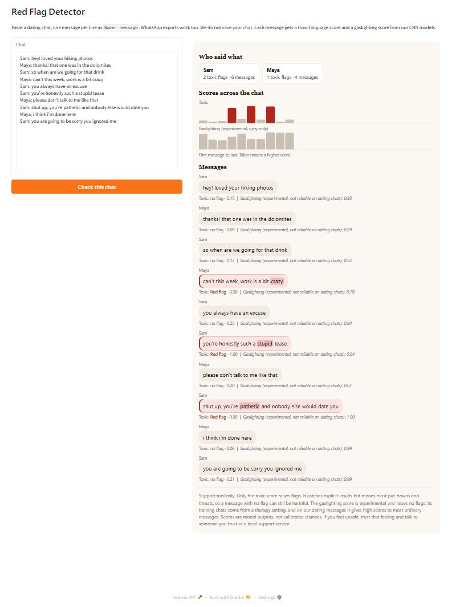

# Red Flag Detector

Red Flag Detector looks for two things in dating-app chats: toxic language and gaslighting. Each gets its own score. No public dataset of real dating chats exists, so we train on online comments (toxic) and AI-written chats (gaslighting), then test how well that carries over to dating messages.

**Research question:** can models trained outside dating spot toxic language and gaslighting in dating messages, and does our own CNN do as well as pretrained DistilBERT?

IE University, AI: Machine Learning & Analytics, Group 7: Alexander Glapiak, Alp Kurtbolat, Raya Metchkarova, Milan Josifovikj, Aysel Zeynalova, Sacha Benayoun.



## Status

| Part | State |
|---|---|
| Package structure and tests | Done, 50 tests |
| EDA on D1, D3 and the dating messages | Done (`notebooks/03_eda_d1_d3.ipynb`) |
| TF-IDF baseline, CNN with GloVe, DistilBERT frozen and fine-tuned | Trained on both topics |
| Error analysis | Mistakes exported per model; the team is reading them |
| Dating test | 120 messages (development set) and 80 team-written messages (final test), labels reviewed by the group |
| Final test runs | Sunday 22 November, once |
| Prototype | v1 gives a toxic and a gaslighting score from the CNN models. v2 (next step): a model switcher, with fine-tuned DistilBERT hosted as a GitHub release |
| Report and slides (due 24 November) | In progress |

## Results so far

F1 for the harmful class. We chose hyperparameters and thresholds on validation data. The dating numbers come from the 120-message development set, and no official test set has been scored yet.

| Model | D1 validation | Dating: toxic vs harmless | D3 validation | Dating: gaslighting vs harmless | Harmless dating messages flagged by the D3 model |
|---|---:|---:|---:|---:|---:|
| TF-IDF + logistic regression | 0.58 | 0.38 | 0.95 | 0.31 | 75% |
| CNN + GloVe | 0.63 | 0.41 | 0.95 | 0.25 | 98% |
| DistilBERT, frozen | 0.44 | 0.50 | 0.94 | 0.15 | 65% |
| DistilBERT, fine-tuned | 0.68 | 0.40 | 0.97 | 0.19 | 92% |

Fine-tuned DistilBERT is best on the training domains. On dating messages the models fall within each other's wide intervals: they catch explicit insults and miss put-downs and threats. The gaslighting models learn D3's style instead of gaslighting, because D3's safe class is reassuring therapist language. Each `results/<model>/metrics.json` has the full numbers, and `notebooks/03_eda_d1_d3.ipynb` explains the D3 problem.

## Setup

Use Python 3.12 or newer. We tested on 3.13.

```bash
python -m venv .venv
source .venv/bin/activate        # Windows: .venv\Scripts\activate
pip install -r requirements.txt
pip install -e .
```

With conda instead:

```bash
conda env create -f environment.yml
conda activate red-flag-detector
```

PyTorch comes with the base install because the app runs the CNN. Training DistilBERT also needs transformers:

```bash
pip install -e ".[deep]"
```

pip installs the CPU build of PyTorch, which is enough for the app. For training on an NVIDIA GPU, install the CUDA build from pytorch.org first. We trained on an RTX 2070 with `torch` 2.14.1+cu126 and `transformers` 5.23.0.

## Run the prototype

```bash
python -m red_flag_detector.app
```

Open http://127.0.0.1:7860 and paste a chat with one `Name: message` per line. Each message gets two scores, toxic language and gaslighting, from our CNN models in `models/`, so you do not need any data to run it. Highlighted words are the ones that raised a flagged score most.

Only the toxic score raises flags. The gaslighting score appears as a grey number marked experimental and never flags a message: like every model we trained on D3, it gives high scores to most ordinary dating messages (see Results). Without PyTorch the app falls back to the TF-IDF baselines. To try other saved models, pass `--toxic-model` or `--gaslighting-model` with a `.pt` or `.joblib` file.

## Get the data

Raw data stays out of Git. All datasets contain offensive language. See [data/README.md](data/README.md) for sources and licences.

| Data | How to get it |
|---|---|
| D1 Toxic Conversations | Nothing to do: the code downloads it from Hugging Face on first use (635 MB) |
| D3 Gaslighting | `python -c "from huggingface_hub import hf_hub_download as d; [d('Maxwe11y/gaslighting', f'{c}_{s}.json', repo_type='dataset', local_dir='data/raw/gaslighting') for c in ('gaslighting', 'anti_gaslighting') for s in ('train', 'validation', 'test')]"` |
| GloVe 6B 100d (CNN only) | Download `glove.6B.zip` (862 MB) from the `stanfordnlp/glove` repo on Hugging Face and put `glove.6B.100d.txt` in `data/raw/` |
| D2 Jigsaw (extra test) | Log in to Kaggle and put `test.csv` and `test_labels.csv` in `data/raw/` |
| Dating messages | Already in `data/dating_stress_test.csv` |

## Reproduce the results

```bash
pytest -q
python -m red_flag_detector.baseline --dataset d1      # TF-IDF, toxic
python -m red_flag_detector.baseline --dataset d3      # TF-IDF, gaslighting
python -m red_flag_detector.cnn --dataset d1           # CNN, toxic (add --dataset d3 for gaslighting)
python -m red_flag_detector.transformer --dataset d1 --mode frozen
python -m red_flag_detector.transformer --dataset d1 --mode finetuned
python -m red_flag_detector.errors                     # mistakes per model, into results/errors/
```

Each run writes `results/<model>/metrics.json`, the flag rate per dating category and every dating mistake. On an RTX 2070, the CNN takes about a minute per setting and fine-tuned DistilBERT about 17 minutes on D1.

Fine-tuned DistilBERT weights are 265 MB each, so Git ignores them. Run the fine-tuned commands to recreate them. The other models are in `models/`.

## How we keep the evaluation honest

- Every toxic model trains on the same 100,000 D1 messages and is tuned on the same 20,000. We removed duplicates and every D1 train text that also appears in the official test file.
- D3 keeps its official splits, which share no chats. We use assistant turns only and drop the `internal thought` field, which states the speaker's intent.
- Dating messages S001 to S120 are a development set, because we have read the models' mistakes on them. S121 to S200 are the final test: `load_stress_test()` leaves them out unless you pass `part="final"`.
- Each official test set runs once, at the end.

## The dating messages

Claude drafted messages S001 to S120, which we use as a development set. A team member wrote S121 to S200 following [data/labelling/WRITER_BRIEF.md](data/labelling/WRITER_BRIEF.md), and the group reviewed them together and agreed with every label. We did not have two people label independently, so we report no inter-annotator agreement.

New here? Read [PROJECT_GUIDE.md](PROJECT_GUIDE.md) for decisions, rules and the work split.

## Project layout

```
├── data/                   dating messages, writer brief, download instructions
├── models/                 saved models (fine-tuned DistilBERT excluded)
├── notebooks/              01 EDA on D2, 02 first baseline, 03 EDA on D1 and D3
├── results/                metrics, figures and mistakes per model
├── src/red_flag_detector/
│   ├── data.py             loaders and splits for D1, D2, D3 and the dating messages
│   ├── validation.py       column, label and leakage checks
│   ├── baseline.py         TF-IDF and logistic regression
│   ├── cnn.py              CNN over GloVe vectors
│   ├── transformer.py      DistilBERT, frozen and fine-tuned
│   ├── evaluate.py         metrics, threshold, intervals
│   ├── errors.py           mistakes per model for error analysis
│   ├── labelling.py        optional two-person labelling and Cohen's kappa (not used)
│   ├── chat.py             chat parsing and word effects
│   ├── plots.py            chart style
│   └── app.py              Gradio prototype
└── tests/
```

## Responsible use

The app supports a person's own judgement and makes no decisions for them. A low score does not mean a message is safe. Pasted chats include another person's messages, so we do not save them.

## AI use

We used Claude (Anthropic) to write the package code, tests, prototype, notebooks and this README, to run the training, and to draft version 0.1 of the dating test. Every team member needs to review and be able to explain this work. The report gives the full declaration.

## References

- Kim, Y. (2014). Convolutional Neural Networks for Sentence Classification. EMNLP 2014.
- Li et al. (2025). Can a Large Language Model be a Gaslighter? ICLR 2025. Source of D3.
- Pennington, J., Socher, R. and Manning, C. D. (2014). GloVe: Global Vectors for Word Representation. EMNLP 2014.
- Sanh, V., Debut, L., Chaumond, J. and Wolf, T. (2019). DistilBERT, a distilled version of BERT. arXiv:1910.01108.
