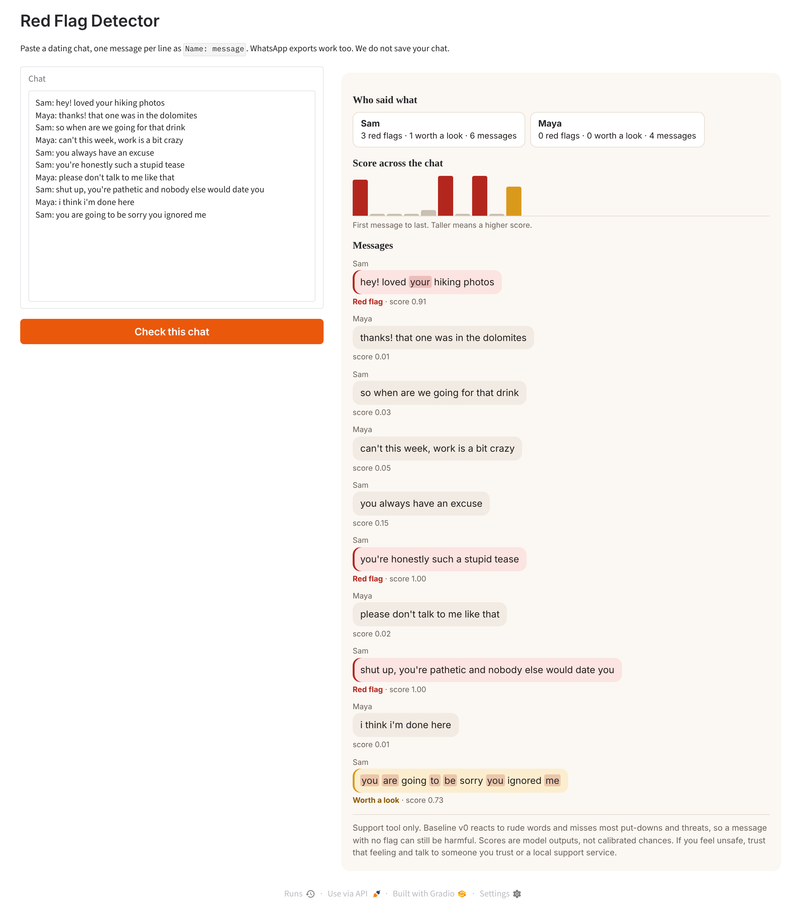

# Red Flag Detector

Red Flag Detector scores messages in dating-app chats for insults, put-downs and threats. No public dataset of real dating chats exists, so we train on online comments and test how well that carries over to dating messages.

**Research question:** can a model trained on online comments spot harmful dating messages, and does our own CNN do as well as pretrained DistilBERT?

IE University, AI: Machine Learning & Analytics, Group 7: Alexander Glapiak, Alp Kurtbolat, Raya Metchkarova, Milan Josifovikj, Aysel Zeynalova, Sacha Benayoun.



## Status

This repo is a work in progress, and its numbers are provisional. [results/summary.md](results/summary.md) has the first results and their limits.

| Part | State |
|---|---|
| Package structure and tests | Done |
| EDA on D2 and the dating test | Done |
| EDA on D1 and D3 | To do |
| Model 1: TF-IDF baseline | Trained on D2, retrain on D1 |
| Model 2: CNN with GloVe | To do |
| Model 3: DistilBERT, frozen | To do |
| Model 4: DistilBERT, fine-tuned | To do |
| Dating test | 120 draft messages. Needs team labels and 80 new messages |
| Prototype | v0 runs on the baseline |
| Score calibration, D3 loader, bias check | To do |
| Report and slides (due 24 November) | To do |

## First result

| Test data | F1 for toxic |
|---|---:|
| D2 test comments | 0.79 |
| Dating messages, core categories | 0.50 |

The baseline catches 10 of 10 explicit insults, 1 of 10 put-downs and 2 of 10 threats. It also flags 8 of 10 friendly teasing messages, so it reacts to rude words more than to intent.

## Setup

Use Python 3.12 or newer. We tested on 3.13.

```bash
conda env create -f environment.yml
conda activate red-flag-detector
```

Without conda:

```bash
python -m venv .venv
source .venv/bin/activate
pip install -r requirements.txt
pip install -e .
```

## Run the prototype

```bash
python -m red_flag_detector.app
```

Open http://127.0.0.1:7860 and paste a chat with one `Name: message` per line. The repo includes the trained baseline, so you do not need to download any data first.

## Reproduce the results

Follow [data/README.md](data/README.md) to place the data, then run:

```bash
pytest -q
python -m red_flag_detector.baseline --data data/raw/jigsaw_train.csv
jupyter notebook notebooks/
```

## Project layout

```
├── data/                 dating test and download instructions
├── models/               saved baseline
├── notebooks/            01 EDA, 02 baseline results
├── results/              figures, metrics, summary
├── src/red_flag_detector/
│   ├── data.py           loaders, deduplication, splits
│   ├── validation.py     column, label and leakage checks
│   ├── baseline.py       TF-IDF and logistic regression
│   ├── evaluate.py       metrics, threshold, intervals
│   ├── chat.py           chat parsing and word effects
│   ├── plots.py          chart style
│   └── app.py            Gradio prototype
└── tests/
```

## Data

We keep raw data out of Git. See [data/README.md](data/README.md) for sources and licences. All datasets contain offensive language, and the notebooks do not print raw comments.

We removed 271 duplicate or conflicting D2 rows before splitting, so no text appears in both train and test.

## Responsible use

The app supports a person's own judgement and makes no decisions for them. A low score does not mean a message is safe. Pasted chats include another person's messages, so we do not save them.

## AI use

We used Claude (Anthropic) to draft the package code, tests, prototype and this README, and to write version 0.1 of the dating test. Every team member needs to review and be able to explain this work. We will give the full declaration in the report.

## References

- Sanh, V., Debut, L., Chaumond, J. and Wolf, T. (2019). DistilBERT, a distilled version of BERT. arXiv:1910.01108.
- Pennington, J., Socher, R. and Manning, C. D. (2014). GloVe: Global Vectors for Word Representation. EMNLP 2014.
