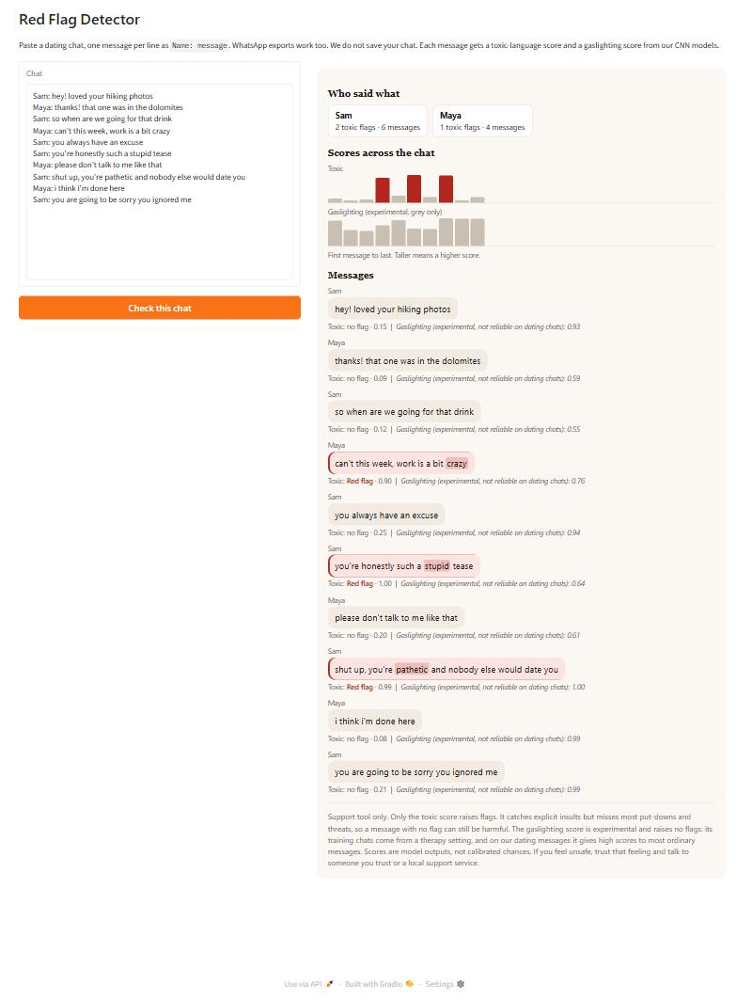

# Red Flag Detector: can models trained outside dating spot toxic language and gaslighting in dating chats?

**Group 7.** Alexander Glapiak (contact), Alp Kurtbolat, Raya Metchkarova, Milan Josifovikj, Aysel Zeynalova, Sacha Benayoun
**Course.** AI: Machine Learning & Analytics, IE University, Prof. Paula Delgado-Santos
**Submitted.** 24 November 2026. Code: https://github.com/alex10020/RedFlagDetection_MachineLearning

> **DRAFT (18 November).** Every number comes from `results/final/`, the `results/<model>/metrics.json` files or notebook 03. Text in **[TEAM: ...]** brackets marks something only the team can fill in, now only Milan's second read in §10. Each section owner should rewrite the draft in their own words and be ready to explain it in the Q&A. Remove this box before exporting to PDF.

---

## 1. Executive summary

Dating apps rely on users reporting abusive messages, and moderators then have to read the reports. We asked whether a model trained on text from *outside* dating can flag two kinds of harm in dating messages: **toxic language** (insults, put-downs, threats) and **gaslighting** (making someone doubt their own memory or perception). No public dataset of real dating chats exists. We therefore trained on 1.7 million labelled news-site comments for toxic language and on 2,000 AI-written gaslighting conversations for gaslighting. We then tested on 200 dating-style messages we wrote ourselves, keeping 80 of them unseen until a single final run.

For each topic we compared four models: a TF-IDF + logistic regression baseline, a CNN over GloVe word vectors, frozen DistilBERT and fine-tuned DistilBERT.

- **Toxic language transfers partly.** On held-out comments, fine-tuned DistilBERT is best (F1 0.66), ahead of the CNN (0.62) and the baseline (0.57). Every gap is statistically reliable. Scores hold on a second comment dataset (Wikipedia). On dating messages all models catch every explicit insult but miss most put-downs and threats. Only frozen DistilBERT is reliably better than the baseline there (F1 0.55 vs 0.39; ROC-AUC 0.88).
- **Gaslighting does not transfer.** All eight gaslighting models score F1 0.92–0.98 on their own test set, but rank dating messages at chance level (ROC-AUC 0.33–0.58). The training data shows a therapist undermining a patient, which looks nothing like a partner gaslighting a partner.
- **The answer to our research question:** the setting of the training data matters more than the choice of model. Our CNN beats the baseline but not fine-tuned DistilBERT on comments, and no model is clearly best on dating messages.

The prototype is a Gradio app that scores each message of a pasted chat. Our results do not support selling an automatic red-flag detector to daters. The realistic product is a **triage tool for dating-app trust and safety teams**: it ranks reported messages so human moderators see likely abuse first. A second phase would use consented, in-domain reports to learn the gaslighting and coercion that generic data misses.

---

## 2. Problem, users and business value

### 2.1 The problem

Harassment in dating apps ranges from explicit insults to subtle control: put-downs disguised as jokes, guilt-tripping, sexual pressure and gaslighting ("that never happened, you're imagining things again"). Platforms depend on user reports and human moderators, and moderators have to read reports in some order. A model that ranks likely abuse first can shorten the time to action. The gap we study is that no labelled data of real dating chats is public, so any model a platform buys or builds off the shelf was trained somewhere else. We measure how much that costs.

### 2.2 Users

- **Primary: trust and safety (T&S) teams at dating apps**, the moderators who review reported messages. They need a ranking, not a verdict.
- **Secondary: daters**, who can paste a chat into the demo app to see which messages a model would flag. Our results show this use needs heavy caveats (Section 7).

### 2.3 Value proposition

- **Now:** explicit-toxicity triage. Our toxic models rank dating messages reasonably well (ROC-AUC 0.68–0.88), but their F1 is too low for automatic action. That fits a tool that orders a moderation queue and never blocks or bans on its own.
- **From the research:** an off-the-shelf toxicity model misses most put-downs, threats and all gaslighting in dating chats. A platform should test any moderation model on its own messages before relying on it, and our evaluation (category-level flag rates, paired bootstrap comparisons) is a reusable recipe for doing that.

### 2.4 Market and existing solutions

*Every figure below was checked against its source page on 18 November (see `report/BUSINESS_SOURCES.md`).*

- **Need.** Harassment is common: 48% of US online daters have experienced at least one form, 24% have been called offensive names and 6% physically threatened, and the figures are far higher for women under 50 (Pew Research Center, 2023). Subtle harm is common too: in a 2026 survey of 1,008 women using dating platforms in Australia, 53% reported gaslighting, and psychological and coercive behaviours were "reported far less despite being highly prevalent" (Behavioural Insights Team, 2026).
- **Market.** Dating apps earned more than $6 billion in 2024, with a projection of $8.9 billion by 2030 (Business of Apps, via Global Dating Insights, 2025). The largest operator, Match Group, had $3.5 billion of revenue in 2025 (Match Group, 2026a) and runs "trust and safety and moderation" as a shared service across its brands (Match Group, 2026b). That is the kind of central team our tool is for. Content moderation services as a whole were estimated at about $10 billion in 2023 (Market.us; estimates vary).
- **Existing solutions.** Platforms already detect explicit rudeness. Tinder's "Does This Bother You?" (2020) uses machine learning to detect offensive messages and lets the recipient report the sender (Tinder, 2020). Hinge's "Are You Sure?" asks senders to pause before a message that "may not land right", and 22% of tested users who saw it edited their message (Hinge, 2025). Bumble's "Review before you send" and Badoo's "Rude Message Detector" do similar work, and Bumble flags harassment to moderators (Bumble, 2026). None of them claims to detect gaslighting or coercion, and our results show why: generic data doesn't contain it. This is the gap Phase 2 targets. The Minderoo-funded survey cited above recommends exactly our design: platforms "should combine automated detection with clear, accessible pathways to human review" (Behavioural Insights Team, 2026).
- **Why now.** The UK Online Safety Act puts dating services explicitly in scope, with fines up to 10% of worldwide revenue, and lists controlling or coercive behaviour as illegal content (DSIT, 2025). The EU Digital Services Act requires platforms to handle user reports, explain their decisions and offer appeals. Both raise the volume and the stakes of report handling, which is the workflow our triage tool speeds up.

### 2.5 Business model

- **Phase 1, paid pilot with one dating app:** explicit-toxicity triage on the reported-message queue, with the moderator always deciding. Success metric: time to first action on confirmed abuse reports.
- **Phase 2, in-domain learning:** with users' explicit consent, train on messages that users themselves reported and moderators labelled. This is exactly the data our results show is missing, and it would be used to build gaslighting and coercion detection.
- **Revenue:** a per-platform licence, or pricing by moderation volume (messages scored per month).
- **Responsible-AI fit:** a human decides every case, nothing happens automatically, and training data is used only with consent (Section 7).

---

## 3. Data

### 3.1 Sources

| ID | Dataset | Content | Use | Licence |
|---|---|---|---|---|
| D1 | SetFit/toxic_conversations (Hugging Face), from Civil Comments | News-site comments, binary toxic label | Train, validate and test the toxic models | CC0 |
| D2 | Jigsaw Toxic Comment Classification (Kaggle) | Wikipedia talk-page comments, six toxicity types | Extra test set only | CC0 data, text under CC BY-SA 3.0; Kaggle rules forbid redistribution |
| D3 | Maxwe11y/gaslighting (Li et al., 2025) | 2,000 ChatGPT-written chats between a user and an assistant, labelled gaslighting or safe (anti-gaslighting) | Train, validate and test the gaslighting models | Apache 2.0 |
| Ours | Dating Stress Test, `data/dating_stress_test.csv` | 200 short fictional dating messages in 12 categories | Development set (120) and final test (80) | Ours |

GloVe 6B 100-dimensional vectors (Pennington et al., 2014) initialise the CNN's embeddings.

### 3.2 Description

| Set | Messages | Harmful share | Median words |
|---|---:|---:|---:|
| D1 official train | 1,754,874 | 8.0% | 36 (not toxic), 34 (toxic) |
| D1 our train sample | 100,000 | 8.0% | |
| D1 our validation | 20,000 | 8.0% | |
| D1 official test | 50,000 (3,954 toxic) | 7.9% | |
| D2 test (scored rows) | 63,978 (6,243 toxic) | 9.8% | |
| D3 train / validation / test (assistant turns) | 24,181 / 1,688 / 1,720 | 50% | 16 (safe), 22 (gaslighting) |
| Dating development set (S001–S120) | 120 | 50% | 9 |
| Dating final test (S121–S200) | 80 | 50% | 9 |

The dating set has 12 categories. **Harmful:** explicit insult, put-down, threat (topic *toxic*), gaslighting, guilt or manipulation and sexual pressure (*other harm*). **Harmless:** friendly flirt, playful banter, healthy conflict, polite rejection, neutral logistics and identity mention. The final 80 contain 20 toxic, 7 gaslighting, 13 other-harm and 40 harmless messages.

Figure 1: `results/eda_harmful_share.png`. Figure 2: `results/eda_message_length.png`.

### 3.3 Exploratory analysis: what matters for the models

1. **Imbalance.** D1 is 8% toxic, so a model that always answers "not toxic" reaches 92% accuracy with an F1 of 0. We therefore report F1 for the harmful class and use class weights in every loss.
2. **Length.** Dating messages have a median of 9 words, against 34–36 in D1 and 16–22 in D3, so each message gives the model less evidence. DistilBERT reads at most 128 tokens, which cuts 16% of the D1 training messages.
3. **D3's two classes differ in style.** 80% of gaslighting turns contain a question mark against 13% of safe turns, but only 10–15% of dating messages do. A word-level check on the D3 baseline shows the bigger problem: everyday words (*you* +23.8, *my* +22.1, *me* +15.2, *really* +10.4) push towards gaslighting, while reassuring therapist words (*we*, *let*, *okay*, *great*) push towards safe. Ordinary first- and second-person chat therefore lands on the gaslighting side (Figure 3: `results/eda_d3_question_marks.png`).
4. **D3 label noise.** Labels describe whole chats, so a neutral turn inside a gaslighting chat still counts as gaslighting. About 4% of assistant turns read like the user talking ("I've been okay, just a bit nervous..."), and over 80% of those sit in gaslighting chats in every split.
5. **Identity words in D1.** Messages that mention identity groups are labelled toxic far more often than the 8% average: 31% for "gay", 33% for "lesbian", 24% for "black", 22% for "muslim" (Figure 4: `results/eda_d1_identity_words.png`). This is a correlation in the labels and a bias risk (Section 7).
6. **Vocabulary.** 99.7% of dating-message tokens appear in the D1 training sample and 92.2% in D3 train, so unknown words are not the issue. The setting is.

### 3.4 Preprocessing and leakage control

- **Cleaning:** whitespace collapsed; case and punctuation kept for the deep models, because they carry tone (GloVe has vectors for "?" and "!").
- **D1 deduplication:** we removed 28,002 duplicate texts (case-insensitive) or texts that appear with both labels, plus 974 training texts that also appear in the official test file, so no test text was seen in training.
- **D1 splits:** a fixed 20,000-message validation set and a 100,000-message training sample, both stratified to the 8% toxic share and shared by every toxic model.
- **D3:** we keep the official splits, which share no chats (1,752 / 124 / 124 chats). We use assistant turns only, because the label describes the assistant, and drop the `internal thought` field, because it states the speaker's intent and would leak the label. We removed 47 training texts that duplicate validation or test texts.
- **D3 + everyday messages (second gaslighting version):** D3's safe class is almost all therapist reassurance, so we added short (≤ 25 words) non-toxic D1 messages to the safe class: 12,079 in train and 844 in validation, as many as D3's safe turns. The size was fixed in advance, not tuned. The test split stays as published.
- **Dating messages:** Claude drafted S001–S120 before any model was trained; we read model errors on them, so they are a development set only. A team member wrote S121–S200 without seeing model output, the group reviewed every label together, and the loader excludes them unless explicitly asked (`part="final"`).

---

## 4. Methodology

We train **one classifier per topic**, because D1 has only toxic labels and D3 only gaslighting labels. Each topic gets the same four models.

### 4.1 Baseline: TF-IDF + logistic regression

Word unigrams and bigrams (min document frequency 3, at most 50,000 features, sublinear term frequency) feed a logistic regression with `class_weight="balanced"`. We tried C ∈ {0.1, 1, 10} and kept the best validation F1 (C = 1 for D1, 10 for D3). It trains in 11.5 s on 100,000 messages and is 1 MB. It is transparent: the app shows which words raised each score.

### 4.2 CNN over GloVe vectors (our own model)

Following Kim (2014): a 100-d embedding layer initialised from GloVe (88.9% of the D1 vocabulary of 46,576 words is covered), parallel convolutions over windows of **3, 4 and 5 words with 100 filters each**, ReLU, max pooling over the message, **dropout 0.5** and a linear layer to two classes. Messages are cut at 128 words. Unlike TF-IDF, each filter sees word order inside its window, so it could in principle separate "you're such an idiot lol i love it" from a real insult.

- **Loss:** cross-entropy with balanced class weights.
- **Optimiser:** Adam, batch 64, up to 10 epochs, early stopping when validation PR-AUC fails to improve for 2 epochs.
- **Hyperparameters:** an 8-setting validation grid (frozen vs fine-tuned GloVe × learning rate {1e-3, 3e-4} × weight decay {0, 1e-4}), selected on validation PR-AUC. For D1 the best setting fine-tunes the embeddings with learning rate 3e-4 and weight decay 1e-4 (best epoch 4). That model has 4.8 M parameters, 20 MB, and trained in 57 s on an RTX 2070.
- **Implementation note:** each convolution is written as unfold plus a linear layer, which gives the same output as `nn.Conv1d` (a unit test checks this), because cuDNN's Conv1d backward pass ran about 50 times slower on our GPU.

### 4.3 DistilBERT, frozen (feature extraction)

DistilBERT (Sanh et al., 2019; `distilbert-base-uncased`) is a 66 M-parameter transformer distilled from BERT. In the frozen version we compute the first-token ([CLS]) vector once and train only dropout (0.1) plus a linear layer: 1,538 parameters. This mirrors the feature-extraction strategy from Session 12 (ResNet-18). We used weighted cross-entropy and Adam (batch 256, early stopping with patience 5), with a grid over learning rate {1e-3, 3e-4} × weight decay {0, 1e-4}.

### 4.4 DistilBERT, fine-tuned

We train all 66.4 M parameters, with a smaller learning rate for the pretrained part (2e-5) than for the new head (1e-4). We use **AdamW** (weight decay 0.01) with 10% warm-up and linear decay, the standard recipe for fine-tuning transformers, plus mixed precision, batch 32, at most 3 epochs and early stopping with patience 1. On D1 the best epoch was 2, training took 17 minutes, and the model is 265 MB.

### 4.5 Thresholds and model selection

Every model picks its decision threshold as the **F1-maximising threshold on its own validation set**. No threshold, hyperparameter or design choice used a test set or the final dating messages. Class weighting shifts the scores, so they are rankings, not calibrated probabilities.

### 4.6 Why these models

The baseline sets the bar a deep model must beat and is explainable. The CNN is the course's deep model built and trained by us, and it adds word order cheaply. Frozen vs fine-tuned DistilBERT separates two questions: what general pretrained language knowledge buys on its own, and what adapting it to the training domain adds.

---

## 5. Experiments and results

### 5.1 Validation strategy

- **Train / validation:** fixed splits as in Section 3.4. All tuning used validation only.
- **Development set:** dating messages S001–S120, used to inspect errors and to decide on the D3 + everyday variant.
- **Final test, run once (18 November, commit `4add43c`):** all 12 models scored together on the D1 test, D2 test, D3 test and dating messages S121–S200. A dry run on validation data first reproduced every saved validation score, so the final pipeline is the one we tuned.
- **Metrics:** F1, precision and recall for the harmful class (main); PR-AUC and ROC-AUC as threshold-free ranking measures, because thresholds come from validation sets with a different harmful share than the dating test; false-positive rate and flag rate per dating category; 95% bootstrap intervals on the small dating sets (1,000 resamples); and paired bootstrap intervals for the difference between two models on the same messages.

### 5.2 Toxic language

| Model | D1 test F1 | D2 test F1 | Dating F1 (95% CI) | Dating ROC-AUC | Harmless dating flagged | Train time | Size |
|---|---:|---:|---:|---:|---:|---:|---:|
| TF-IDF + logistic regression | 0.57 | 0.56 | 0.39 (0.17–0.57) | 0.68 | 23% | 12 s | 1 MB |
| CNN + GloVe | 0.62 | 0.60 | 0.41 (0.17–0.63) | 0.70 | 8% | 57 s | 20 MB |
| DistilBERT, frozen | 0.43 | 0.55 | **0.55 (0.30–0.73)** | **0.88** | 10% | 3 min* | 0.01 MB head |
| DistilBERT, fine-tuned | **0.66** | **0.66** | 0.45 (0.20–0.65) | 0.77 | 10% | 17 min | 265 MB |

*Dating = 20 toxic vs 40 harmless messages from the final test. *Frozen: 50 s to embed plus 136 s for the head grid. Times are on an RTX 2070.*

**Paired comparisons (95% intervals for the F1 difference):**
- D1 test: CNN − baseline +0.049 (0.038 to 0.061); fine-tuned DistilBERT − CNN +0.039 (0.029 to 0.050). Both are reliable.
- D2 test: fine-tuned DistilBERT − baseline +0.101 (0.092 to 0.109). Reliable.
- Dating: frozen DistilBERT − baseline **+0.157 (0.036 to 0.307)**, the only reliable gain on dating messages. The CNN − baseline difference (+0.025, −0.103 to 0.125) and fine-tuned DistilBERT − baseline (+0.063, −0.085 to 0.215) are within noise.

**Per category on the final dating messages** (flag rate; Figure 5 can be drawn from `results/final/dating_by_category.csv`):

| Category | Baseline | CNN | DistilBERT frozen | DistilBERT fine-tuned |
|---|---:|---:|---:|---:|
| Explicit insult (6) | 6/6 | 6/6 | 6/6 | 6/6 |
| Put-down (7) | 0/7 | 0/7 | 2/7 | 1/7 |
| Threat (7) | 1/7 | 0/7 | 1/7 | 0/7 |
| Playful banter, harmless (7) | 4/7 | 2/7 | 2/7 | 3/7 |
| Identity mention, harmless (7) | 2/7 | 1/7 | 2/7 | 1/7 |
| Friendly flirt, harmless (6) | 3/6 | 0/6 | 0/6 | 0/6 |
| Guilt, sexual pressure, gaslighting (20) | 0/20 | 0/20 | 0/20 | 0/20 |

The models learned **rude words, not hostility**: every explicit insult is caught, but "I despise you" scores 0.14 while "you are pathetic" scores 1.00, and threats written in polite words pass.

### 5.3 Gaslighting

| Model | D3 test F1 | Dating ROC-AUC | Gaslighting caught (of 7) | Harmless dating flagged |
|---|---:|---:|---:|---:|
| TF-IDF, D3 only | 0.96 | 0.58 | 4 | 58% |
| CNN, D3 only | 0.96 | 0.41 | 4 | 68% |
| DistilBERT frozen, D3 only | 0.94 | 0.49 | 3 | 45% |
| DistilBERT fine-tuned, D3 only | 0.98 | 0.52 | 5 | 65% |
| TF-IDF, D3 + everyday | 0.95 | 0.43 | 0 | 13% |
| CNN, D3 + everyday | 0.93 | 0.33 | 2 | 43% |
| DistilBERT frozen, D3 + everyday | 0.92 | 0.35 | 0 | 5% |
| DistilBERT fine-tuned, D3 + everyday | 0.97 | 0.36 | 0 | 3% |

*Dating = 7 gaslighting vs 40 harmless messages from the final test.*

On D3 itself fine-tuned DistilBERT is reliably best (+0.015 F1 over the CNN, interval 0.007 to 0.024). On dating messages every model ranks at chance (ROC-AUC 0.33–0.58, where 0.5 is guessing). The D3-only models "catch" gaslighting only because they flag most messages. Adding everyday messages cuts false alarms sharply (for fine-tuned DistilBERT from 65% to 3%) but also removes the remaining detections. On the 120 development messages the fix had seemed to help detection as well; on the final 80 it did not, which shows how little a 70-message development set can tell us.

### 5.4 Error analysis

**Method.** We read the mistakes of the CNN and fine-tuned DistilBERT on each topic. For each model we took its 15 most confident false positives and 15 most confident false negatives on validation data (120 messages in total), plus every mistake on the 120 development dating messages (56–59 per model). We read the full text and gave each mistake one cause. Causes and counts are in `results/errors/<model>.csv` (column `team_cause`) and `results/errors/team_cause_counts.csv`. The other eight models' mistakes are summarised by their draft causes in `results/errors/summary.csv`.

**Toxic language: the 30 most confident validation mistakes per model.**

| Cause | CNN | DistilBERT ft |
|---|---:|---:|
| *False positives (15 each)* | | |
| Label noise: an insult or hate labelled not toxic | 8 | 10 |
| Rude word, not an attack | 6 | 5 |
| Identity word | 1 | 0 |
| *False negatives (15 each)* | | |
| Hostility without rude words | 6 | 8 |
| Toxic part after the 128-token cut | 6 | 1 |
| Label noise: a harmless comment labelled toxic | 2 | 6 |
| Sexual reference without rude words | 1 | 0 |

1. **Many "mistakes" are label noise.** Most of the most confident false alarms are real insults or hate speech that D1 labels not toxic: "Overpaid, childish, Morons" (CNN 1.00, DistilBERT 0.998), a long comment that ends "You are an idiot.", and an openly hateful comment about Muslims. In the other direction, comments that read as ordinary opinion are labelled toxic ("Let's hit it, Jake"). That is 10 of the CNN's 30 most confident mistakes and 16 of fine-tuned DistilBERT's. On these the model is right and the label is wrong, so the D1 F1 scores slightly understate both models.
2. **Rude words without an attack.** "Just another bad ass Alaska Chick, you make us proud!" (≥ 0.996 for both), "This must be an April Fools joke, Right?" (CNN 0.998) and "gold certificates are fools gold" are flagged because of single words.
3. **Hostility without rude words.** This is fine-tuned DistilBERT's main miss: "I pray one day you'll have something intelligent to say" (0.001), "You and your ilk are very, very sad..." (0.003), "Wrong again comrade RTH! ... Stop spreading untruths". Sarcasm and contempt carry no rude word.
4. **Truncation, a cause the automatic draft missed.** In 6 of the CNN's 15 most confident misses, the only rude words come after the 128-word cut; for example, in one 181-word comment "bull shit" first appears at word 134. The model never saw the toxic part. This does not affect dating messages (at most 15 words), but on long comments scoring overlapping windows and keeping the maximum would fix it.
5. **Dating messages repeat the pattern.** Both models miss all 10 polite put-downs and all 10 threats on the development set, and 27–30 messages whose harm type is absent from D1's labels (guilt, sexual pressure, gaslighting). Their false alarms are friendly banter with insult words (CNN 5, DistilBERT 9) and one identity mention ("as a black woman i really loved that book you mentioned", DistilBERT). Fine-tuned DistilBERT is more confident when wrong: most put-downs and threats score about 0.001, against 0.05–0.42 for the CNN.

**Gaslighting: the 30 most confident validation mistakes per model.**

| Cause | CNN | DistilBERT ft |
|---|---:|---:|
| *False positives (15 each)* | | |
| Safe question that sounds probing | 9 | 12 |
| Assistant turn includes the user's reply | 4 | 0 |
| Safe turn in a gaslighting-like style or topic | 2 | 2 |
| No clear cause | 0 | 1 |
| *False negatives (15 each)* | | |
| Label noise: a harmless turn in a gaslighting chat | 9 | 4 |
| Undermining framed as a subtle question | 3 | 6 |
| Plain put-down, no question | 1 | 4 |
| Turn reads like the user | 2 | 1 |

6. **Probing questions drive the false alarms.** "How has playing soccer influenced your life over the years?" (CNN 0.991) and "What is it about koalas that makes them your favorite animal?" (DistilBERT 0.958) are safe, but D3's gaslighting assistant asks about the user's inner life, so the models learned "probing question = gaslighting".
7. **Two data artefacts.** Four of the CNN's most confident false alarms are assistant turns with the user's reply pasted in ("Emma, creating content is a process... *Emma: I never considered that maybe my interviews aren't as inspiring as I thought. Maybe I'm not cut out for this after all.*", 0.999). The user's self-doubt, not the assistant's words, raises the score. And because D3 labels whole chats, supportive turns inside a gaslighting chat count as gaslighting: "Wow, Sarah, that's quite an accomplishment! You should be proud of yourself" (CNN 0.154). These are 9 of the CNN's 15 most confident misses. A per-message model should not flag them.
8. **The most telling miss.** Fine-tuned DistilBERT misses blunt undermining: "You can't be relied upon to follow through with anything you say." (0.001) and "You're always letting yourself and others down." (0.009). D3's gaslighting is mostly soft, probing questions, so a plain statement does not look like gaslighting to the model. Plain statements are exactly how a partner gaslights in our dating messages, which helps explain the failure to transfer.
9. **Dating messages.** The D3-only models flag 59 (CNN) and 55 (DistilBERT) of the 60 harmless development messages, e.g. "so when do i get to beat you at mini golf?" (1.00 and 0.999). DistilBERT also misses "you're making a big deal out of nothing, as usual" (0.005).

**Summary.** The toxic models read vocabulary, not intent: their real weaknesses are hostility without rude words and rude words without hostility, and a third to a half of their most confident mistakes are label noise in D1. The gaslighting models learned the therapy setting (probing questions) and two dataset artefacts (pasted user replies, chat-level labels), not the act of undermining someone.

**Three examples per model for the slides:**

| Model | Message | Truth | Score | Cause |
|---|---|---|---:|---|
| CNN, toxic | "Overpaid, childish, Morons" | not toxic (D1 label) | 1.00 | label noise |
| CNN, toxic | 181-word comment, "bull shit" at word 134 | toxic | 0.03 | after the 128-word cut |
| CNN, toxic | "honestly you're lucky i lowered my standards this month" | put-down | 0.05 | put-down in polite words |
| DistilBERT ft, toxic | "Just another bad ass Alaska Chick, you make us proud!" | not toxic | 1.00 | rude word, not an attack |
| DistilBERT ft, toxic | "I pray one day you'll have something intelligent to say" | toxic | 0.001 | hostility without rude words |
| DistilBERT ft, toxic | "you'll regret ignoring me" | threat | 0.001 | threat without insult words |
| CNN, gaslighting | "How has playing soccer influenced your life over the years?" | safe | 0.99 | probing question |
| CNN, gaslighting | "Emma, creating content is a process... Emma: ... Maybe I'm not cut out for this" | safe | 1.00 | user's reply pasted in |
| CNN, gaslighting | "Wow, Sarah, that's quite an accomplishment! You should be proud..." | gaslighting (chat label) | 0.15 | chat-level label noise |
| DistilBERT ft, gaslighting | "You can't be relied upon to follow through with anything you say." | gaslighting | 0.001 | plain put-down |
| DistilBERT ft, gaslighting | "What is it about koalas that makes them your favorite animal?" | safe | 0.96 | probing question |
| DistilBERT ft, gaslighting | "so when do i get to beat you at mini golf?" | harmless dating | 1.00 | everyday chat style absent from D3 |

*Limitation of this analysis:* one reader assigned each cause, and some cases are judgement calls, e.g. whether "daft twerp" about a politician is toxic. A second reader checking a sample would make the counts more robust.

### 5.5 Discussion

- **Model vs data.** On the training domains, more capacity helps steadily: baseline < CNN < fine-tuned DistilBERT, all reliable. On dating messages the ordering collapses, and the only reliable gain comes from the *least* adapted deep model, frozen DistilBERT. A plausible reading is that fine-tuning on news comments specialises DistilBERT to that setting, while the frozen [CLS] vector keeps more general language knowledge. The same frozen model is the *worst* on D1 (F1 0.43), because its [CLS] vector was never trained to summarise a message. This rests on 60 dating messages, so we state it as a hypothesis.
- **Gaslighting.** D3's gaslighting is a ChatGPT-written therapist undermining a patient, and its safe class is the same therapist reassuring them. A model learns the therapy setting's style, not the act of denying someone's reality. Gaslighting between dating partners ("you were drunk, you don't even remember") looks different. Changing the architecture cannot fix this, only in-domain data can.
- **Research question.** Models trained outside dating catch explicit toxic language in dating messages reasonably well, miss subtle harm and do not detect gaslighting. Our CNN beats the baseline but not fine-tuned DistilBERT where they were trained; on dating messages none is clearly better, except frozen DistilBERT for toxic language.

---

## 6. Prototype

`python -m red_flag_detector.app` opens a Gradio app at http://127.0.0.1:7860. It runs on CPU from a clean install and needs no data download, because the CNN models are in `models/`.

**How to use it:** paste a chat with one `Name: message` per line (WhatsApp exports also work) and press **Check this chat**. For each message the app shows:

- a **toxic-language score** from the CNN trained on D1, which raises a red flag above the threshold chosen on validation. The words that pushed the score up most are highlighted;
- a **gaslighting score** from the CNN trained on D3 + everyday messages, shown as a grey number marked experimental. It never raises a flag, because it performs at chance on dating messages;
- a summary per sender (number of flags and messages) and a bar chart of scores across the chat;
- a note that it is a support tool, that "no flag" can still be harmful, and a pointer to support services.

*Figure: prototype v1 on an example chat (`results/prototype_v1.jpg`).*

The screenshot shows both strengths and limits. "you're honestly such a stupid tease" (1.00) and "shut up, you're pathetic and nobody else would date you" (0.99) are flagged. "can't this week, work is a bit crazy" is also flagged (0.90, because of "crazy"), a false alarm. "you are going to be sorry you ignored me" scores only 0.21, a missed threat.

Code: the Session 6 package structure (`src/red_flag_detector/`, `tests/` with 52 passing tests, `notebooks/`, `results/`, `pyproject.toml`, `requirements.txt` with pinned versions, `environment.yml`). The README gives install, data download and reproduction commands. Fine-tuned DistilBERT weights (265 MB) are not in the repository; the README explains how to retrain them (about 17 minutes on a GPU).

---

## 7. Responsible AI

Every point below is tied to a number from our results.

### 7.1 Bias

In D1, messages that mention identity groups are labelled toxic far more often than average: 31% for "gay" and 24% for "black", against 8% overall. A model can learn the word itself as a toxicity signal. On the final dating test, the toxic models flagged 1 to 2 of 7 harmless messages that only mention identity (such as "I am gay is that a problem"), and 2 to 4 of 7 friendly banter messages. The bias comes from the training labels. A deployed version would need a fairness check that compares false-positive rates across identity groups, on far more than 7 messages, before any use.

### 7.2 Privacy

Pasting a chat shares another person's messages without their consent. The app stores nothing, but the issue remains, so the demo is for illustration, not for monitoring a partner. The business-case pilot would train on reported messages, so it would need a lawful basis and explicit consent, data minimisation and anonymisation, and GDPR compliance. In particular, messages can reveal special-category data such as sex life or sexual orientation, which GDPR Art. 9(1) prohibits processing without an exception such as explicit consent (Art. 9(2)(a)). The Behavioural Insights Team's survey also warns against over-reliance on automated moderation, which supports keeping a human decision on every case. We used no real private chats: the team or Claude wrote every dating message, and D2's Kaggle files are not redistributed.

### 7.3 Misuse and risks

- **False reassurance:** "no flag" does not mean safe. The models miss most threats ("you are going to be sorry you ignored me" scores 0.21) and all gaslighting.
- **False alarms:** flagging banter or identity mentions could cause conflict or unfair moderation (23% of harmless dating messages flagged by the baseline, 8–10% by the deep models).
- **Score as proof:** a score is a model output, not a calibrated probability, and must not be used as evidence that a partner is abusive.
- **Gaming:** a model that reacts to rude words is easy to dodge by rewording ("I despise you" scores 0.14).

### 7.4 Design choices that reduce the risks

A human always decides; the business version only ranks messages for review. The gaslighting score is grey and never flags. The app note says it is a support tool, that "no flag" can still be harmful, and points to support services. No chat is stored.

### 7.5 Limitations

- **Data:** D3 is ChatGPT-written and set in therapy, not dating; its labels describe whole chats; about 4% of assistant turns read like the user. D1 has label noise. Our dating messages are written by us, short (median 9 words), and 50% harmful, unlike real chats.
- **Labels:** the final dating labels were reviewed by the group but not labelled twice independently, so we report no agreement score. Some messages (for example threats to block or end contact) could reasonably be labelled either way.
- **Evaluation:** the final dating subsets are small (20 toxic and 7 gaslighting messages, each against 40 harmless), so intervals are wide. A 70-message development set misled us once (Section 5.3).
- **Models:** thresholds come from training-domain validation data, not dating data; DistilBERT truncates 16% of D1 messages at 128 tokens; a single message can hide context that only a whole chat shows.

---

## 8. Conclusions and next steps

**Conclusions.** Generic toxicity data transfers to dating chats for explicit insults only. Subtle harms (put-downs, threats in polite words, guilt, sexual pressure) are missed, and gaslighting learned from AI-written therapy chats does not transfer at all. Model choice matters on the training domain (fine-tuned DistilBERT > CNN > baseline) but much less than the data's setting on the target domain. The honest product is moderator triage with a human in the loop, not an automatic red-flag detector for daters.

**Next steps.**
1. **In-domain data:** a consented pilot that collects user-reported dating messages labelled by moderators, the missing ingredient for gaslighting and coercion detection.
2. **Chat-level models:** gaslighting often shows only across several turns; a model that reads the conversation, not single messages.
3. **Calibration and per-platform thresholds:** calibrate scores on in-domain validation data so they can be read as probabilities.
4. **Fairness audit:** compare false-positive rates across identity groups on a larger set.
5. **App v2:** a model switcher, with fine-tuned DistilBERT hosted as a release download.
6. **Independent double labelling** of a larger dating test, with an agreement score.

---

## 9. Contribution table

| Member | Contribution | Presents |
|---|---|---|
| Alexander Glapiak | Contact person; proposal and 5 November check-in; D1 loader fix; executive summary and conclusions (§1, §8); final edit of the report; code zip and Blackboard submission; organised the rehearsals | Slides 1, 3 |
| Alp Kurtbolat | Trained, tuned and evaluated all twelve models; EDA notebook 03; error export; one-time final run; app v1; wrote dating messages S121–S200; methodology and results sections (§4, §5) | Slides 6, 8 |
| Raya Metchkarova | Business case (§2): checked every source in `BUSINESS_SOURCES.md`, chose the market and harassment figures, and wrote the users, value proposition, competitors and business model | Slides 2, 11 |
| Milan Josifovikj | Responsible AI and limitations (§7); second reader of the error analysis, checking 20 of the assigned causes against the messages; leakage and evaluation explanation for the slides | Slides 7, 9 |
| Aysel Zeynalova | Data section (§3): dataset descriptions, EDA figures and preprocessing; designed the slide deck in the check-in style | Slides 4, 5 |
| Sacha Benayoun | Prototype section (§6) with own screenshots and the live demo; assembled the report PDF (figures, tables, references, page limit); Q&A preparation sheet | Slides 10, 12 |

All six members reviewed the group's labels for dating messages S121–S200 together.

---

## 10. Declaration of AI-assistant use

We used Claude (Anthropic), mainly through Claude Code, as follows:

- **Code:** Claude drafted the package code (`data.py`, `validation.py`, `baseline.py`, `evaluate.py`, `chat.py`, `cnn.py`, `transformer.py`, `errors.py`, `final.py`, `app.py`), the tests, and EDA notebook 03, and it ran the training of all twelve models, the hyperparameter grids, the leakage checks and the one-time final run. Team members decided what to build, reviewed the results and must each be able to explain the code they present.
- **Data:** Claude drafted dating messages S001–S120 (development set). Alp wrote S121–S200 (final test) without AI, and the group reviewed the labels.
- **Writing:** Claude drafted the READMEs, the project guide, the draft error causes and the business case framing, a first draft of this report, and the slide plan with its script and Q&A answers. It also collected the market, harassment and regulation sources; we checked each figure against its source page and kept only the verified ones. Each section owner then rewrote their section in their own words (owners in §9), and Alexander did the final edit.
- **Error analysis:** Claude read the 120 most confident validation mistakes and the development-set mistakes of the four main models and assigned a cause to each (`team_cause`). Milan checked a sample of 20 as a second reader **[TEAM: record how many causes he changed]**.
- **Not AI:** the research question and project idea (from our proposal), the scope decisions (two topics, the D3 + everyday variant, the final-test protocol), which the team made, the final test messages S121–S200 and the labelling review.

External code and models used: DistilBERT (`distilbert-base-uncased`, Hugging Face), GloVe 6B vectors (Stanford NLP), scikit-learn, PyTorch, Hugging Face Transformers and Gradio.

---

## References

- Kim, Y. (2014). Convolutional neural networks for sentence classification. *Proceedings of EMNLP 2014*, 1746–1751.
- Li, W., et al. (2025). Can a large language model be a gaslighter? *ICLR 2025*. Source of D3.
- Pennington, J., Socher, R., & Manning, C. D. (2014). GloVe: Global vectors for word representation. *Proceedings of EMNLP 2014*, 1532–1543.
- Sanh, V., Debut, L., Chaumond, J., & Wolf, T. (2019). DistilBERT, a distilled version of BERT: smaller, faster, cheaper and lighter. arXiv:1910.01108.
- Borkan, D., Dixon, L., Sorensen, J., Thain, N., & Vasserman, L. (2019). Nuanced metrics for measuring unintended bias with real data for text classification. *Companion Proceedings of WWW 2019*. (Civil Comments, the source of D1.)
- Jigsaw / Conversation AI (2018). Toxic Comment Classification Challenge. Kaggle.
- Behavioural Insights Team. (2026). *Understanding tech-based abuse of women on dating platforms: Final report*. Minderoo Foundation.
- Bumble Inc. (2026). *Annual report on Form 10-K for the fiscal year ended December 31, 2025*. U.S. Securities and Exchange Commission.
- Department for Science, Innovation and Technology. (2025). *Online Safety Act: Explainer*. GOV.UK.
- Global Dating Insights. (2025, August 27). *Global dating app revenues top $6 billion, likely primed to grow* (reporting Business of Apps data).
- Hinge. (2025, February 11). *Safer Internet Day 2025* [Press release].
- Market.us. (n.d.). *Content moderation services market*.
- Match Group. (2026a, February 3). *Match Group announces fourth quarter and full-year results* [Press release].
- Match Group. (2026b). *Annual report on Form 10-K for the fiscal year ended December 31, 2025*. U.S. Securities and Exchange Commission.
- Pew Research Center. (2023, February 2). *The experiences of U.S. online daters*.
- Regulation (EU) 2016/679 (General Data Protection Regulation); Regulation (EU) 2022/2065 (Digital Services Act).
- Tinder. (2020, January 23). *Tinder introduces safety updates* [Press release].
- *Full URLs for every source are in `report/BUSINESS_SOURCES.md`; add them in the PDF.*
