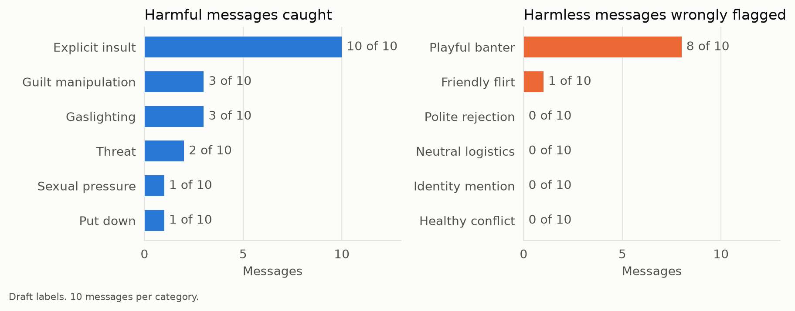

# Results so far (5 November 2026)

These numbers are provisional. We trained the baseline on D2 because D1, our main toxic dataset, has not run yet. No gaslighting data has trained any model yet, so the gaslighting row shows how a toxic-language model handles gaslighting. Labels on the dating test are an AI draft that the team has not reviewed.

| Test data | Messages | Precision | Recall | F1 for toxic | F1 95% interval |
|---|---:|---:|---:|---:|---:|
| D2 test comments | 31,860 | 0.81 | 0.77 | 0.79 | not computed |
| Dating: toxic vs harmless | 90 | 0.59 | 0.43 | 0.50 | 0.31 to 0.65 |
| Dating: gaslighting vs harmless | 70 | 0.25 | 0.30 | 0.27 | 0.00 to 0.50 |
| Dating: all messages | 120 | 0.69 | 0.33 | 0.45 | 0.32 to 0.57 |

Always answering "not toxic" reaches 89.8% accuracy on the D2 test and an F1 of 0.

## What we see

- The baseline catches all 10 explicit insults, but only 3 of 10 gaslighting messages, 2 of 10 threats and 1 of 10 put-downs.
- "that never happened, you're imagining things again" scores 0.13. Gaslighting uses ordinary words, so a word-count model trained on toxic comments has little to go on. This gap is why gaslighting is one of our two main topics.
- It flags 8 of 10 friendly teasing messages, such as "you're such an idiot lol i love it".
- It flags 0 of 10 messages that mention identity and 0 of 10 polite rejections. Ten messages per category cannot rule out bias, so we need a larger check.
- It scores "hey! loved your hiking photos" at 0.91. The word "your" has a logistic regression weight of +11.2, so it counts as strong evidence in a short message.
- Dating test messages have a median of 9 words, against 38 and 23 for non-toxic and toxic D2 comments. We wrote those messages ourselves, so this gap needs checking on real chat data.

## What this means for the next models

We will train one classifier per topic, because D1 has only toxic labels and D3 has only gaslighting labels. A CNN sees word order over 3 to 5 words, and DistilBERT sees the whole sentence. Both could separate "you're such an idiot lol i love it" from a real insult, so we now have a specific test for the research question. Threats may stay hard for both, because D2 has only 478 threat comments among 159,571.

## Limits of these numbers

- Half of the dating test is harmful, far above real chats, so its F1 does not compare directly with F1 on comments.
- With 90 to 120 messages, the intervals stay wide.
- We have now seen the errors on this version of the test, so we count it as a development set. The final numbers need the 80 messages we have not written yet, kept away from every tuning choice.
- Class weighting shifts the scores, so they are not yet true probabilities.
